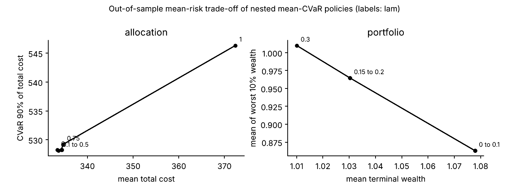
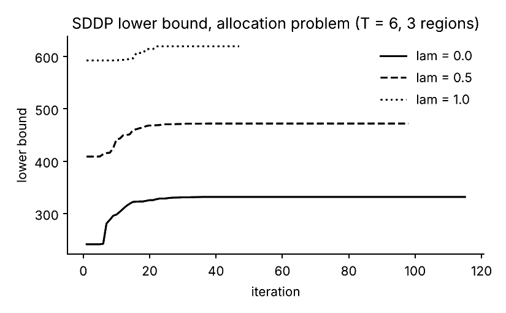

# mean-risk-sddp

Time-consistent mean-risk policies for multi-stage stochastic linear programs.

When a decision maker cares about both the expected cost and the risk of a sequence of decisions under uncertainty, the way risk is measured over time matters. Minimizing a mean-CVaR of the *total* cost at the start gives a plan that the decision maker would want to change later on: the problem is not time consistent. Applying the risk measure recursively, stage by stage, gives a time-consistent policy that can be computed by dynamic programming, and in particular by SDDP.

This repository implements both views for linear problems with stagewise independent, finitely supported noise, checks SDDP against exact solutions, and compares the policies on two test problems.

## Model

At stage t = 1, ..., T the noise xi_t is observed and the stage problem

```
min  c_t^T y_t + theta_t
s.t. A_t y_t + E_t x_{t-1} = b_t(xi_t),   y_t in Y_t,   x_t = y_t[state]
```

is solved. With rho(Z) = (1 - lam) E[Z] + lam CVaR_alpha(Z), two objectives are considered.

**Nested (time consistent)**

```
V_t(x_{t-1}, xi_t) = min  c_t^T y_t + rho( V_{t+1}(x_t, xi_{t+1}) )
```

**Static (decided once at the root)**

```
min  rho( sum_t c_t^T y_t )
```

## What is implemented

- **SDDP** with risk-neutral and nested mean-CVaR cuts (`mrsddp/sddp.py`). The cut weights are the dual weights of mean-CVaR at the trial point (Shapiro 2011; Philpott and de Matos 2012). The first-stage value is a lower bound on the nested objective.
- **Extensive forms** on the full scenario tree for the risk-neutral, nested and static objectives (`mrsddp/extensive.py`), with CVaR in Rockafellar-Uryasev form at every node.
- **Re-planning study** (`mrsddp/consistency.py`). The static problem is solved at the root and re-solved at every stage-2 node for the remaining horizon. Naive re-planning changes the plan and worsens the root objective. Carrying the root CVaR threshold eta* and the cost already paid as extra state restores consistency. In the terms of Kovacova and Rudloff (2021), the scalarization moves along the tree instead of staying fixed.
- **Simulation-tuned policies** (`mrsddp/policies.py`). A parametric target-level policy is tuned by SPSA on sampled paths, as a cheap policy-search baseline against SDDP.

## Test problems

- **`MultiRegionAllocation`**: a central supplier with limited capacity ships a scarce resource to several regions with one period of lead time. Demand is seasonal and random. Unmet demand is lost and penalized, and leftover stock is held at a cost.
- **`Portfolio`**: multi-period portfolio selection with proportional transaction costs. The objective is terminal wealth (costs are negative wealth).

## Results

All numbers are produced by the scripts in `scripts/` and stored in `results/`.

**SDDP vs. extensive form** (`validate.py`). On 12 small instances (both problems, lam in {0, 0.5, 1}, alpha = 0.8), the SDDP lower bound reaches the optimal value of the extensive form, with relative differences of at most 3e-15. It takes 32 to 46 iterations.

**Re-planning the static problem** (`time_consistency.py`, allocation T = 4, alpha = 0.8)

| lam | root value | naive re-planning | loss | with (eta*, past cost) as state |
|---|---|---|---|---|
| 0.0 | 101.069 | 101.069 | 0.000 | 101.069 |
| 0.2 | 111.851 | 111.851 | 0.000 | 111.851 |
| 0.4 | 122.633 | 122.748 | 0.115 | 122.633 |
| 0.6 | 133.415 | 133.529 | 0.114 | 133.415 |
| 0.8 | 144.197 | 144.313 | 0.116 | 144.197 |
| 1.0 | 154.979 | 155.091 | 0.112 | 154.979 |

For lam >= 0.4 the naive re-planner deviates from the root plan, and the root objective of what it actually does is worse. With the augmented state, the re-planned decisions keep the root value exactly.

**Mean-risk trade-off** (`frontier.py`, 2000 out-of-sample paths, alpha = 0.9)



- **Allocation problem:** moderate risk aversion (lam <= 0.75) barely changes the policy. Pure nested CVaR (lam = 1) is worse in both mean and tail of the total cost. Here the nested criterion protects each stage against its own worst case, which is not the same as protecting the total.
- **Portfolio:** a clear frontier. Policies move from the risky assets (lam <= 0.1) to a mixed portfolio (lam = 0.15 to 0.2) and to cash (lam >= 0.3).

**SDDP vs. tuned target policies** (`policy_search.py`, allocation T = 6, risk neutral)

| policy | mean cost | CVaR90 cost | gap to SDDP bound |
|---|---|---|---|
| myopic target (s = 1) | 380.30 | 571.03 | 14.6% |
| SPSA-tuned target | 360.63 | 550.84 | 8.7% |
| SDDP | 333.38 | 528.24 | 0.5% |

Convergence of the lower bound on the allocation problem:



## Usage

```bash
pip install -e ".[dev]"
pytest

python scripts/validate.py
python scripts/time_consistency.py
python scripts/policy_search.py
python scripts/frontier.py
python scripts/figures.py
```

```python
from mrsddp import SDDP, MeanCVaR
from mrsddp.problems import MultiRegionAllocation

model = MultiRegionAllocation(T=6, regions=3, n_scen=5)
sddp = SDDP(model, MeanCVaR(lam=0.5, alpha=0.9)).train(300)
costs = sddp.simulate(1000)
```

A new problem subclasses `MultiStageModel` and implements `support(t)` and `stage_lp(t, xi)`.

## References

- Pereira, M. V. F. and Pinto, L. M. V. G. (1991). Multi-stage stochastic optimization applied to energy planning. Mathematical Programming 52, 359-375.
- Shapiro, A. (2011). Analysis of stochastic dual dynamic programming method. European Journal of Operational Research 209, 63-72.
- Philpott, A. B. and de Matos, V. L. (2012). Dynamic sampling algorithms for multi-stage stochastic programs with risk aversion. European Journal of Operational Research 218, 470-483.
- Rockafellar, R. T. and Uryasev, S. (2000). Optimization of conditional value-at-risk. Journal of Risk 2, 21-41.
- Kovacova, G. and Rudloff, B. (2021). Time consistency of the mean-risk problem. Operations Research 69, 1100-1117.
- Spall, J. C. (1992). Multivariate stochastic approximation using a simultaneous perturbation gradient approximation. IEEE Transactions on Automatic Control 37, 332-341.

## License

MIT
